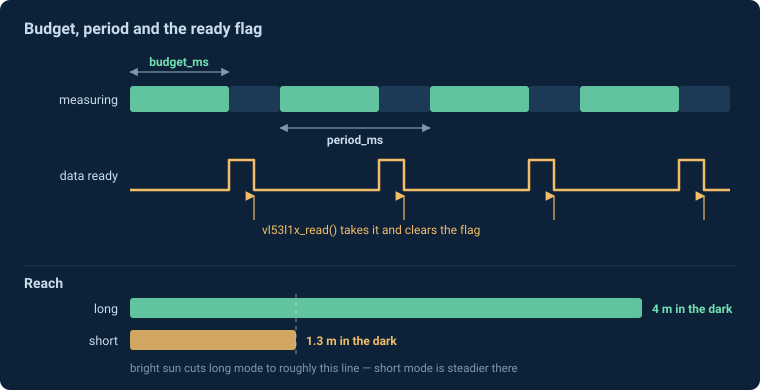

# mcu-tof

Measure distance in millimetres with a VL53L1X time-of-flight sensor over I2C or a TF-Luna single-point lidar over UART or I2C.

**Platforms** · ESP-IDF 5.2+ and STM32 HAL. Hardware testing is pending. The host tests use simulated devices.

## Contents

- [Quick start](#quick-start)
- [Drivers and examples](#drivers-and-examples)
- [Using the library in your project](#using-the-library-in-your-project)
- [License](#license)

## Quick start

Set the I2C pins and keep the VL53L1X XSHUT pin high for normal operation. The example assumes a breakout that pulls it high.

In a terminal with ESP-IDF activated, get the example and select the target for an ESP32. Change the target if your board uses another ESP32 chip.

```sh
git clone https://github.com/JonasAtelier/mcu-tof.git tof
cd tof/examples/esp/vl53l1x
idf.py set-target esp32
```

Check the [wiring guide](docs/hardware.md) and edit the settings in [main.c](examples/esp/vl53l1x/main/main.c) to match your board. Connect the board by USB, then build, upload and open the serial monitor.

```sh
idf.py build flash monitor
```

Move a target to see distance, signal and ambient light readings. Check the status before using a distance, since the device can return a number for an invalid measurement.

## Drivers and examples

Both drivers return a distance and a validity status through `tof_read()`. The VL53L1X example for STM32 waits for GPIO1 to signal a fresh reading. For the TF-Luna, choose the example that matches the module’s UART or I2C mode. [Shared sample API](include/tof.h)

| Chip | Driver header | ESP-IDF project | STM32 HAL example |
|---|---|---|---|
| [VL53L1X](docs/chips.md#vl53l1x) | [vl53l1x.h](include/vl53l1x.h) | [I2C ranging](examples/esp/vl53l1x/) | [I2C with data-ready interrupt](examples/stm/vl53l1x/main.c) |
| [TF-Luna](docs/chips.md#tf-luna) | [tfluna.h](include/tfluna.h) | [UART stream](examples/esp/tfluna_uart/) · [I2C trigger](examples/esp/tfluna_i2c/) | [UART stream](examples/stm/tfluna/main.c) |

## Using the library in your project

- Add the component and enable the driver for your hardware. [Installation and build options](docs/installation.md)
- Open the ESP-IDF project for your hardware, or copy the STM32 example into a project with board setup already in place. [All ESP-IDF examples](examples/esp/) · [All STM32 examples](examples/stm/)
- Look up calls and chip-specific settings. [API usage](docs/usage.md) · [Hardware reference](docs/chips.md)

To run the simulated tests on your computer, run `make -C test test` from the library root. [Test requirements and coverage](docs/development.md)

## License

© 2026 JonasAtelier, [GPL-3.0-only](LICENSE), except the VL53L1X register addresses and configuration
tables in `src/vl53l1x/vl53l1x_regs.h`, which are ST's, from its ultra lite
driver (STSW-IMG009) 3.4.0, under the BSD 3-clause licence: ST's notice is
kept in that file and in [LICENSE-ST](LICENSE-ST). Firmware shipped in
binary form with the VL53L1X driver must reproduce LICENSE-ST in its
documentation or other materials (BSD-3 clause 2).

<p align="center">
  
</p>

[Browse the workshop catalog · ESP32 and STM32 drivers](https://github.com/JonasAtelier/jonas-atelier-libraries#esp32-and-stm32-drivers)
